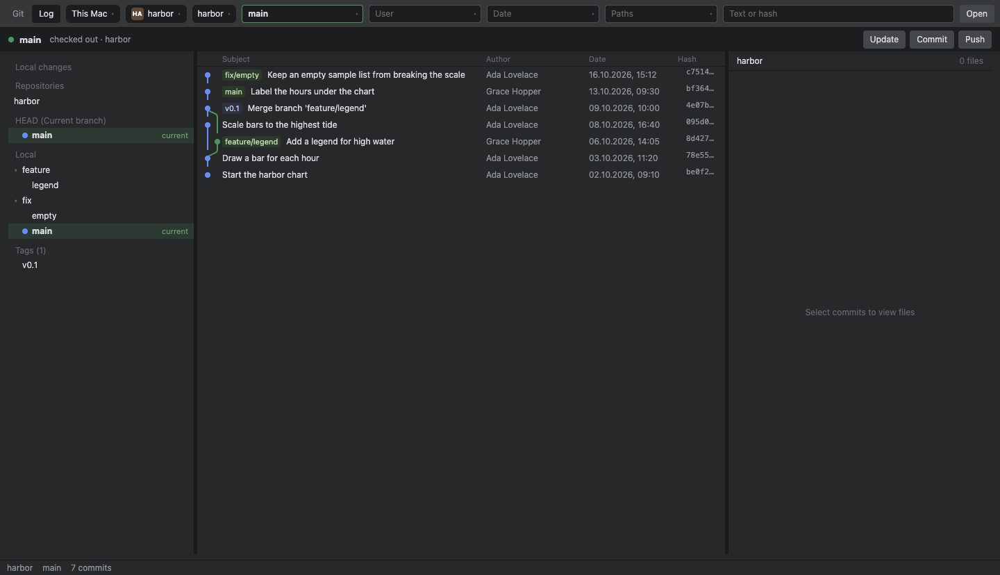
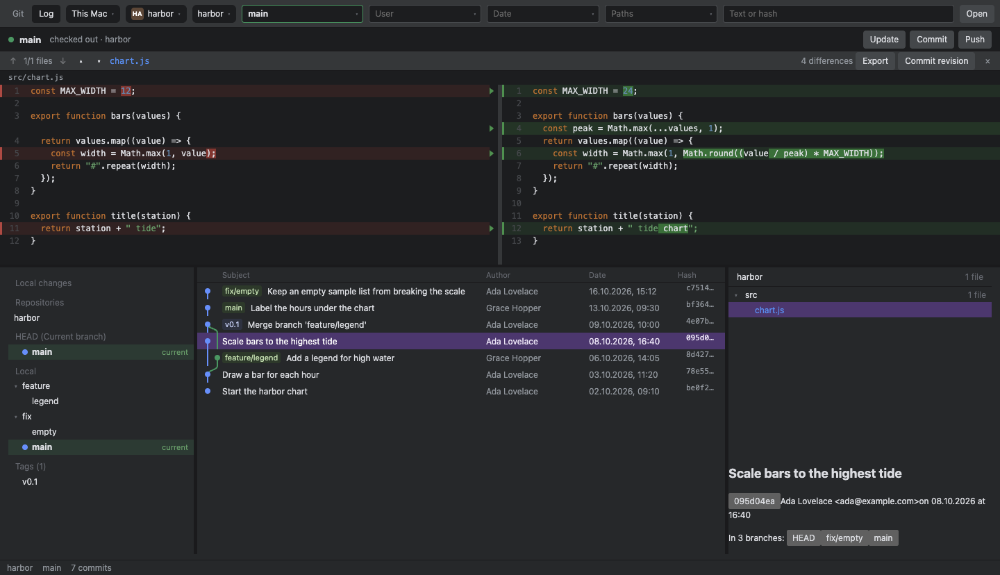
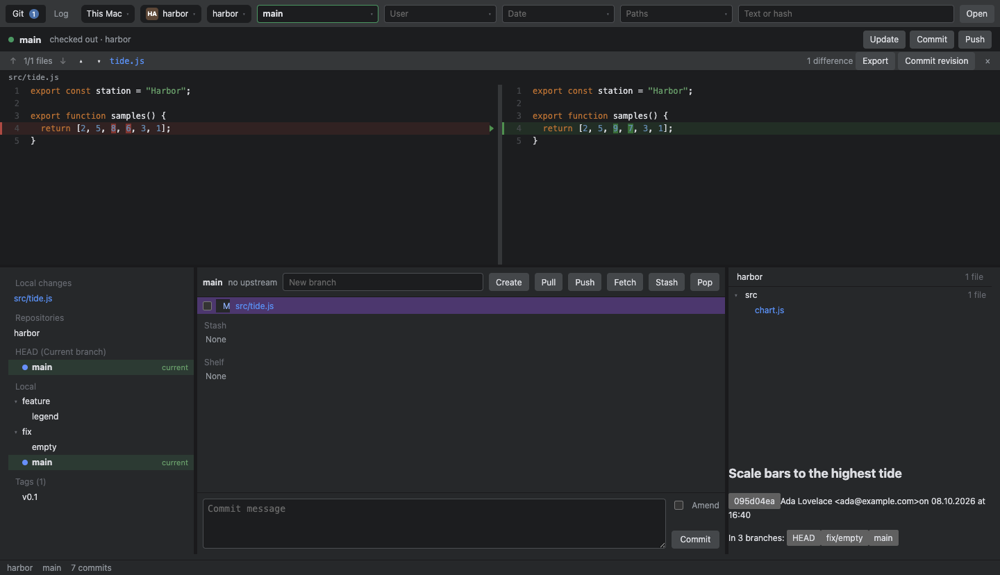
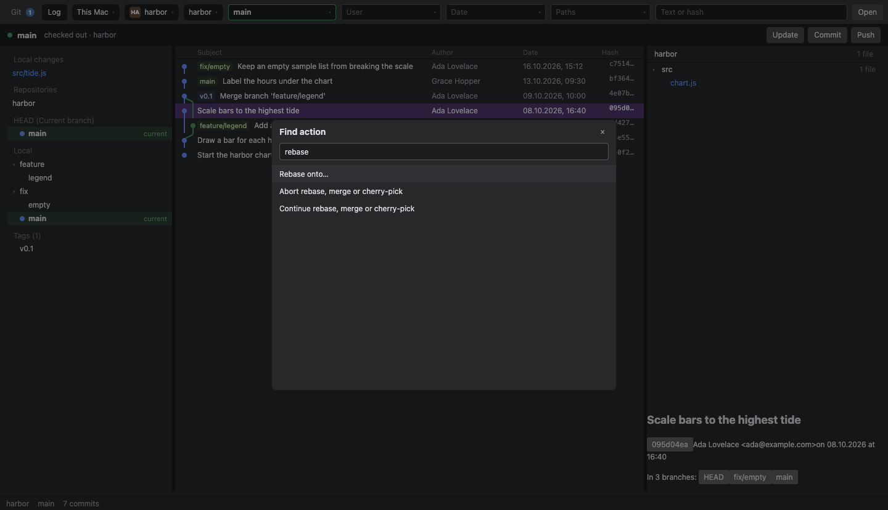

# Jet Git

Desktopový Git klient pro složky na tomhle Macu i na SSH hostu. Otevřená složka je workspace. Gity v ní jdou smíchat do jednoho logu, nebo nechat v logu jen ty zaškrtnuté.



## Co je potřeba

- macOS
- Node.js 22 nebo novější
- `git` na `PATH`
- U vzdáleného počítače SSH host, který už jde klíčem a bez hesla. Aplikace se na heslo neptá.

## Jak to spustit

V kořeni repozitáře:

```sh
npx uu-safe-install
npm start
```

Otevře se okno na posledním workspace. První spuštění je prázdné, projekt se přidá přes **Open**.

## Otevřít projekt

1. **Open** vybere složku. To je workspace, i když v ní leží víc gitů.
2. **This Mac** přepne počítač. Jména bere z `~/.ssh/config`. Na vzdáleném hostu **Open** prochází jeho složky.
3. **Repositories** vpravo vedle workspace určí, které gity jsou v logu. Všechny najednou, nebo jen zaškrtnuté. **Deselect all** log vyprázdní, dokud něco znovu nezaškrtneš.

Vlevo jsou větve. Zelený řádek je checked out větev. Stejná informace je v pruhu nad logem, třeba `main checked out`.

Velká vzdálená složka se poprvé prochází déle. Další otevření už drží SSH spojení.

## Log a diff

Filtry jsou v liště: **Branch**, **User**, **Date**, **Paths**, **Text or hash**. Psaní zužuje nabídku. Velké písmeno bere začátek slova, takže `SB` najde `Scale bars`.

Datum je `dd.mm.yyyy`. Rozsah se píše jako dvě data, třeba `02.10.2026 16.10.2026`. **Paths** bere jméno repozitáře nebo cestu uvnitř něj.

Klik na commit ukáže jeho soubory vpravo. Klik na soubor otevře diff nad logem. Předěl mezi panely se dá táhnout. Přidané řádky jsou zelené, úprava je vidět na obou stranách.



Víc commitů se vybírá Command-klikem. Shift-klik vezme rozsah. Seznam souborů je sloučený ze všech vybraných. Porovnání vybraných commitů je ⌘D.

Pravý klik na commit umí cherry-pick, revert, drop, squash, reset, novou větev, tag, patch a skok na rodiče nebo potomka.

## Update, commit a push

**Update** (⌘T) stáhne změny repozitáře, na který se právě díváš. **Commit** (⌘K) přepne na záložku **Git** a dá kurzor do zprávy. Když zpráva už je napsaná, ⌘K rovnou commitne. **Push** je ⌘⇧K.

Záložka **Git** ukáže lokální soubory. Zaškrtnutí soubor stageuje. Dole je zpráva, **Amend** a **Commit**. Na liště té záložky je **Pull**, **Push**, **Fetch**, **Stash** a **Pop**. **New branch** a **Create** založí větev, volitelně od commitu vybraného jako start.



**Stash** a **Shelf** jsou pod seznamem změn. Shelf je JetBrains shelf z `.idea/shelf`. Řádek se otevře jako patch a dá se aplikovat.

Když je v logu zaškrtnutých víc repozitářů, ve Find action je ještě **Update all shown repositories** a **Push all shown repositories**.

## Akce podle názvu

⌃⇧A nebo ⌘⇧A otevře seznam akcí. Stačí začít psát, třeba `rebase`, `merge`, `cherry-pick`, `stash`, `fetch` nebo `checkout`. Rebase a merge se zeptají na jméno větve. Šipky a Enter vyberou položku, Escape seznam zavře.



## Revize

V diffu klik na číslo řádku přidá komentář k tomu řádku. Shift-klik na stejné straně označí rozsah. **Export** uloží JSON pojmenovaný podle větve, takže `feature/dj_FCCM-111_kokos` dá soubor `feature-dj_FCCM-111_kokos.json`. **Commit revision** zapíše `.jet-git/review.json` na větev `revision/` plus jméno větve, kterou reviduješ. Tvoji pracovní větev to nepřepne a pracovní strom nenechá špinavý.

## Zkratky

| Akce | Zkratka |
| --- | --- |
| Update, tedy pull aktuálního repozitáře | ⌘T |
| Commit | ⌘K |
| Push | ⌘⇧K |
| Find action | ⌃⇧A nebo ⌘⇧A |
| Porovnat vybrané commity | ⌘D |
| Nastavení | ⌘, |
| Zkopírovat hash commitu | ⌥⌘C |

V nastavení je vzhled, průhlednost, velikost textu a zvýraznění syntaxe podle jazyka.

## Testy

```sh
npm test
```

## Z čeho se to skládá

`packages/git-core` volá systémový `git`. `packages/desktop` je okno v Electronu.
